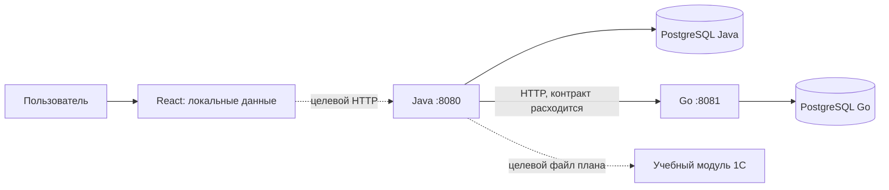

# Архитектура проекта

Сверено с кодом ветки `feature/docs` 21.11.2026. Целевые C4 находятся в [отдельном документе](10-c4-responsibility.md); их наличие не доказывает реализацию контейнеров и API.

| Компонент | Технологии из конфигурации | Фактическое состояние |
| --- | --- | --- |
| React | React 19, React Router 7, Vite 8 | Список изделий/заказов и создание заказа в памяти. Перезагрузка сбрасывает изменения. |
| Java | Java 21, Spring Boot 3.5.16, Hibernate 5.6, XML SessionFactory/DAO, MapStruct | Изделия, заказы и фасад планирования, клиент Go. |
| Go | Версия Go из `go.mod`: 1.27.1; Gin, pgx | GET/POST рабочих центров, live/ready; календарь и планировщик отсутствуют. |
| Хранение | PostgreSQL 17 в Compose | Отдельные БД Java и Go; отдельные схемы/миграции. |
| 1С | Учебный модуль в целевом решении | Исходники и исполняемый обмен в ветке отсутствуют. |

Java владеет изделиями, технологиями и многопозиционными заказами. Go по проекту владеет ресурсами, календарём, планами и назначениями. Сервисы обмениваются снимками и внешними идентификаторами без межбазовых FK; прямой записи в чужую БД нет. Статусы заказа и плана различаются.

## API и текущие разрывы

Java предоставляет `/api/products`, `/api/orders`, `/api/planner`. Полный перечень фасада следует смотреть в `PlanningController.java`: расчёт/чтение плана заказа, центры, доступность, расписание, принятие, отклонение и отмена плана. Это наличие Java-маршрутов, а не работоспособность цепочки.

Go регистрирует только `GET /api/v1/live`, `GET /api/v1/ready`, `GET /api/v1/work-centers`, `POST /api/v1/work-centers`. Java-клиент обращается к `/api/work-centers` без `/v1` и ожидает отсутствующие `/api/plans`, `/api/schedule` и другие методы. Контракт требует согласования; сквозной расчёт пока заблокирован.

Контактов клиента нет в DTO заказа; локальная форма не подтверждает сохранение в Java. Отмена заказа не доказывает освобождение Go-резерва. Порты Java/Go — 8080/8081, PostgreSQL с хоста — 5433, внутри Compose — 5432.

## Решения

[Реестр ADR](adr/README.md) содержит ADR-0001–0007 из исходного архива со статусами согласования. [Обзор стека](adr/0001-tech-stack.md) — навигационный документ, а не восьмое решение. Файловый обмен Java → 1С проектируется отдельно: формат, ревизия, повтор и атомарность должны быть согласованы. Материалы и стоимость — Should. R33–R39 — будущий этап.
