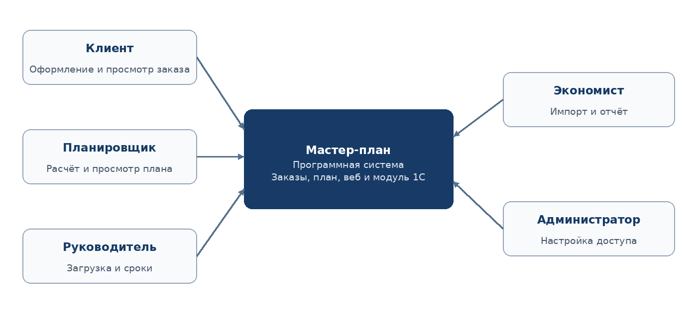
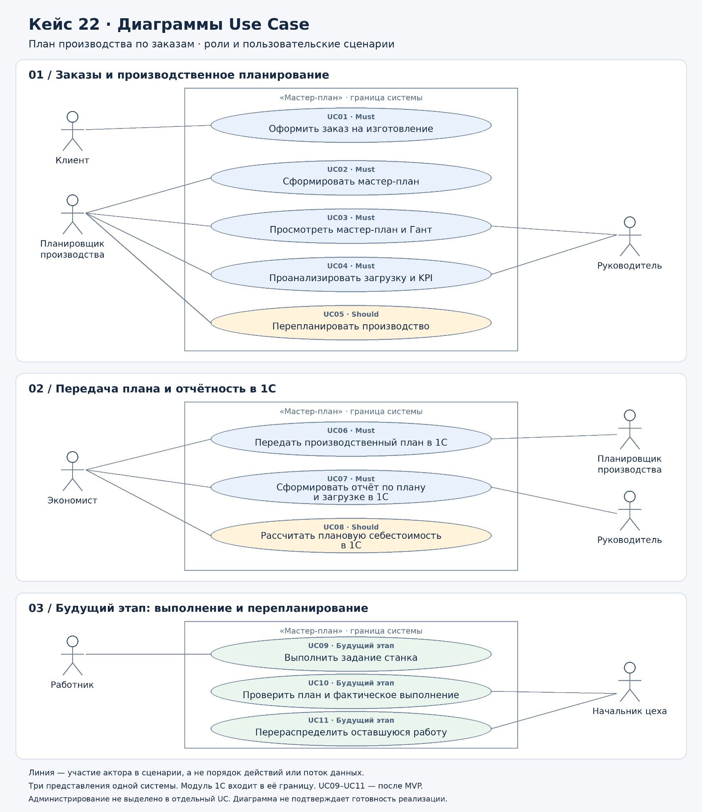

# Use Case, C4 Context и трассируемость

Источник: `UseCase C4 Трассируемость.docx`. Перенос в Markdown: 21.11.2026. Статусы и оценки сохранены из источника; перенос не означает утверждения решений или выполнения проверок.

Сценарии использования и архитектура

Кейс 22 План производства по заказамЕдиный документ • Версия 0.3 от 17 ноября 2026 года

Клиент оформляет заказ на изготовление, а планировщик производства назначает приоритет и запускает расчёт. Документ объединяет акторов, восемь основных сценариев UseCase и три сценария будущего этапа, контекст C4 и трассируемость требований R → A. Сценарии и требования описывают целевой результат; готовность реализации подтверждается отдельно.

1 Акторы и UseCase   •   2 C4 Context   •   3 Трассируемость

1 Акторы и сценарии UseCase

Таблица 6 Акторы системы

| Актор | Тип | Роль доступа |
| --- | --- | --- |
| Клиент | Первичный | Оформление заказа на изготовление и получение подтверждения регистрации. Без доступа к внутреннему плану и производственным приоритетам. |
| Планировщик производства | Первичный | Просмотр поступивших заказов, назначение приоритетов, формирование и просмотр плана, анализ загрузки, перепланирование и выгрузка данных. |
| Руководитель | Первичный | Просмотр мастер-плана, Ганта, сроков, загрузки и KPI; формирование отчётов в 1С. |
| Экономист | Первичный | Загрузка плана в 1С, подготовка отчётов, расчёт затрат на материалы и плановой себестоимости. |
| Администратор | Первичный | Управление доступом (Should) и редактирование справочников через интерфейс (Could). Отдельный сценарий в перечень UseCase не включён. |
| Работник | ПервичныйПосле MVP | Задания закреплённого станка; отметки выполнения и сообщения о проблемах. |
| Начальник цеха | ПервичныйПосле MVP | План/факт своего цеха, уточнение отклонений, запуск и подтверждение пересчёта. Доступ ко всему предприятию определяется отдельно. |

Список UseCase

| Код | Сценарий | Приоритет |
| --- | --- | --- |
| UC01 | Оформить заказ на изготовление | Must |
| UC02 | Сформировать мастер-план | Must |
| UC03 | Просмотреть мастер-план и Гант | Must |
| UC04 | Проанализировать загрузку и KPI | Must |
| UC05 | Перепланировать производство | Should |
| UC06 | Передать производственный план в 1С | Must |
| UC07 | Сформировать отчёт по плану и загрузке в 1С | Must |
| UC08 | Рассчитать плановую себестоимость в 1С | Should |
| UC09 | Выполнить задание станка | После MVP |
| UC10 | Проверить план и фактическое выполнение | После MVP |
| UC11 | Перераспределить оставшуюся работу | После MVP |

Must — обязательные функции; Should — желательные; Could — при наличии времени. Администрирование и остальные функции сохраняют приоритеты MoSCoW. Модуль 1С входит в границу системы; показанные акторы — люди.

Диаграмма Use Case

UC01 Оформить заказ на изготовление

Актор: Клиент. Приоритет: Must.

| Элемент | Описание |
| --- | --- |
| Предусловие | Есть доступные для заказа изделия; клиенту доступна форма оформления заказа. |
| Основной поток | 1. Клиент нажимает «Создать заказ» в разделе «Заказы» и открывает форму без отдельного пункта навигации.2. Добавляет одну или несколько позиций, указывает изделие и положительное целое количество в каждой; задаёт общую желаемую дату, контакты и необязательный комментарий до 200 символов, затем отправляет заказ.3. Система проверяет обязательные поля, допустимость значений и доступность выбранного изделия.4. Система сохраняет шапку и позиции одной транзакцией; повторные изделия объединяются суммированием количества. Заказ получает уникальный номер, дату создания и статус NEW. Контакты сохраняются после расширения модели по R02.5. Система показывает номер и подтверждение регистрации заказа; указанный клиентом срок остаётся желаемым. |
| Альтернативный поток | 3а. Данные некорректны или изделие недоступно — система поясняет причину и сохраняет введённые значения в форме.4а. Сохранение не выполнено — система сообщает об ошибке; частичная запись не создаётся. |
| Постусловие | Заказ зарегистрирован и доступен планировщику производства. Мощности ещё не резервируются; производственный приоритет задаёт сотрудник предприятия.Контакты предусмотрены R02, но текущий DTO dueDate, comment, items их не содержит: требуется расширение модели и API. |

UC02 Сформировать мастер-план

Актор: Планировщик производства. Приоритет: Must.

| Элемент | Описание |
| --- | --- |
| Предусловие | Есть заказы для планирования, корректные технологии, подходящие рабочие центры и календарь. |
| Основной поток | 1. Планировщик производства выбирает поступившие заказы, назначает внутренние приоритеты и запускает расчёт.2. Система проверяет исходные данные и рассчитывает длительности по нормативам и количеству деталей.3. Система учитывает приоритеты, последовательность операций, календарь и занятую мощность.4. Система назначает рабочие центры и интервалы; определяет завершение заказов и опоздание.5. Система сохраняет целостный план и соответствующую загрузку, затем показывает результат.Для каждой позиции соблюдается sequenceNumber; разные позиции могут выполняться параллельно при наличии мощности. |
| Альтернативный поток | 2а. Не хватает технологии, ресурса или календаря — расчёт завершается с перечнем причин.4а. Желаемый срок клиента недостижим — система планирует позже срока, если это возможно, и показывает опоздание; ограничения не нарушаются.5а. Ошибка расчёта или сохранения — прежний согласованный план и его резервирование не заменяются частичным результатом. |
| Постусловие | Сохранён выполнимый по ресурсам план либо сообщена причина неудачи. Повторный запуск не дублирует резервирование уже запланированных операций.Целевой сценарий допускает несколько заказов. Текущий Java-клиент передаёт один заказ за вызов; очередь и управление приоритетом требуют реализации. |

UC03 Просмотреть мастер-план и Гант

Актор: Планировщик производства, руководитель. Приоритет: Must.

| Элемент | Описание |
| --- | --- |
| Предусловие | Пользователю доступен раздел планирования; для основного потока есть сохранённый мастер-план. |
| Основной поток | 1. Пользователь открывает план.2. Система показывает таблицу операций: заказ, рабочий центр, начало и окончание.3. Пользователь переключается на диаграмму Ганта.4. Система отображает те же операции во времени и выделяет заказы с плановым опозданием. |
| Альтернативный поток | 1а. План отсутствует — система сообщает, что сначала нужен расчёт.2а. Для выбранного периода операций нет — выводится пустое представление.3а. При реализации фильтров Should отбор по заказу, срокам и центру одинаково применяется к таблице и Ганту. |
| Постусловие | Таблица и Гант показывают один и тот же план; просмотр не меняет расписание. |

UC04 Проанализировать загрузку и KPI

Актор: Руководитель, планировщик производства. Приоритет: Must.

| Элемент | Описание |
| --- | --- |
| Предусловие | Доступны сохранённый план и календарная мощность за выбранный период. |
| Основной поток | 1. Пользователь открывает аналитику и задаёт период.2. Система показывает занятую и доступную мощность центров по дням.3. Система выводит загрузку в процентах, долю заказов, запланированных в срок, и количество заказов с опозданием.4. Пользователь просматривает центры и заказы, требующие внимания. |
| Альтернативный поток | 2а. Доступная мощность равна нулю — процент не вычисляется; показывается «Нет доступной мощности».3а. Запланированных заказов нет — доля в срок обозначается «Нет данных», а не 100 %. |
| Постусловие | Пользователь получил плановые показатели. Загрузка в процентах равна занятому времени / доступному × 100; доля в срок считается среди заказов выбранного плана и периода. |

UC05 Перепланировать производство

Актор: Планировщик производства. Приоритет: Should.

| Элемент | Описание |
| --- | --- |
| Предусловие | Есть план и изменения заказа, календаря или доступности ресурсов; функция перепланирования реализована. |
| Основной поток | 1. Планировщик производства выбирает план, проверяет изменения исходных данных и запускает пересчёт.2. Система рассчитывает новое расписание с учётом изменений и ограничений.3. Система проверяет результат, согласованно заменяет актуальный план и резервирование мощности.4. Система показывает обновлённые даты, загрузку и признаки опоздания. |
| Альтернативный поток | 2а. Построить расписание нельзя — система объясняет причины; старый план сохраняется, но отмечается как неактуальный для изменённых данных.3а. Ошибка сохранения — частичная замена и двойное резервирование не допускаются. |
| Постусловие | Актуальный план и загрузка согласованы либо пересчёт отклонён. Хранение истории версий для этого сценария не обязательно и относится к Could.Для безопасной замены используется техническая ревизия снимка; это не требует пользовательской истории версий. Пересчёт по фактам выполнения выделен в UC09–UC11 после MVP. |

UC06 Передать производственный план в 1С

Актор: Планировщик производства, экономист. Приоритет: Must.

| Элемент | Описание |
| --- | --- |
| Предусловие | Есть сохранённый план; согласованы формат файла и правила сопоставления данных; доступен модуль 1С. |
| Основной поток | 1. Планировщик производства выбирает сохранённый план и запускает выгрузку.2. Система проверяет полноту данных и формирует файл с идентификатором плана, заказами, операциями, сроками и мощностями.3. Планировщик производства передаёт файл экономисту; экономист выбирает его в модуле 1С.4. 1С проверяет формат, обязательные поля, ссылки и отсутствие повторного импорта того же набора.5. Экономист подтверждает импорт; 1С сохраняет данные и сообщает количество загруженных записей. |
| Альтернативный поток | 2а или 4а. Данные некорректны — операция останавливается с перечнем ошибок.4б. Набор уже загружен — повторные записи не создаются.5а. Ошибка сохранения — неполный набор не становится доступным для отчётности. |
| Постусловие | В 1С загружен согласованный набор данных плана либо сохранено прежнее состояние. Одна лишь выгрузка файла ещё не означает успешный импорт. |

UC07 Сформировать отчёт по плану и загрузке в 1С

Актор: Экономист, руководитель. Приоритет: Must.

| Элемент | Описание |
| --- | --- |
| Предусловие | В 1С успешно загружены данные плана и доступной мощности по UC06. |
| Основной поток | 1. Пользователь открывает отчёт и выбирает план и период.2. 1С формирует сведения об операциях, сроках заказов и загрузке рабочих центров.3. Пользователь просматривает отчёт и плановые отклонения по срокам.4. 1С показывает идентификатор плана и дату использованных данных. |
| Альтернативный поток | 2а. Подходящих данных нет — выводится пояснение без подстановки нулевых фактов.2б. Не хватает данных для загрузки — показатель помечается как недоступный, указывается причина. |
| Постусловие | Отчёт сформирован по конкретному набору данных и согласован с этим планом. После перепланирования для актуального отчёта требуется повторный обмен. |

UC08 Рассчитать плановую себестоимость в 1С

Актор: Экономист. Приоритет: Should.

| Элемент | Описание |
| --- | --- |
| Предусловие | Доступны данные детали или заказа, нормы расхода и цены материалов, технология, нормативы времени и ставки операций. |
| Основной поток | 1. Экономист выбирает деталь или заказ и проверяет количество и исходные данные.2. 1С рассчитывает материалы на одну деталь: суммирует произведения норм расхода на цены материалов.3. 1С рассчитывает операции на одну деталь: умножает нормативное время на ставку, предварительно согласовав единицы времени.4. 1С складывает материалы и операции; умножает затраты на одну деталь на количество деталей в заказе.5. Система показывает плановую себестоимость детали и заказа с расшифровкой материалов и операций. |
| Альтернативный поток | 1а. Нет нормы, цены, ставки или согласованной единицы измерения — система перечисляет недостающие данные.2а или 3а. Значения недопустимы — расчёт прекращается; неполный результат не показывается как итоговый. |
| Постусловие | Получена плановая себестоимость по учебной модели «материалы + операции», без наценки и прибыли. Складские остатки и закупки не изменяются. |

UC09 Выполнить задание станка

Актор: Работник. Этап: после MVP; готовность не подтверждена.

| Элемент | Описание |
| --- | --- |
| Предусловие | Пользователь идентифицирован; определены станок, разрешения и задания действующего плана. |
| Основной поток | 1. Работник открывает задания станка.2. Отмечает начало и выполненное количество, при завершении закрывает операцию.3. При задержке или поломке отправляет сообщение.4. Java проверяет права и допустимость перехода, сохраняет факт, автора и время с устойчивым ID производственной операции. |
| Альтернативный поток | Чужое задание, недопустимое количество или повтор команды: изменение отклоняется либо возвращается прежний результат без дубля. При ошибке данные формы сохраняются. |
| Постусловие | Факт доступен начальнику; отметка не запускает автоматическое перепланирование. |

UC10 Проверить план и фактическое выполнение

Актор: Начальник цеха. Этап: после MVP; готовность не подтверждена.

| Элемент | Описание |
| --- | --- |
| Предусловие | Есть план и доступные пользователю факты; права ограничивают область просмотра. |
| Основной поток | 1. Начальник открывает сводку цеха.2. Сравнивает план и факт, просматривает задержки и сообщения.3. Уточняет причину, интервалы простоя и доступность оборудования.4. Система сохраняет изменения и их автора. |
| Альтернативный поток | Нет фактов — «Нет данных», а не нулевое выполнение. Срок ремонта неизвестен — неизвестность сохраняется, дата не подставляется. |
| Постусловие | Подготовлены актуальные факты и ограничения для пересчёта. |

UC11 Перераспределить оставшуюся работу

Актор: Начальник цеха. Этап: после MVP; готовность не подтверждена.

| Элемент | Описание |
| --- | --- |
| Предусловие | Есть изменения по UC09–UC10 и согласованные правила пересчёта; исходные данные имеют ревизию. |
| Основной поток | 1. Начальник запускает пересчёт.2. Java передаёт Go снимок фактов, остатков и недоступности.3. Go сохраняет завершённое, учитывает выполняющиеся операции и предлагает новый вариант.4. Начальник проверяет изменения и подтверждает вариант.5. Система проверяет актуальность и атомарно заменяет резервы.Частично выполненная работа переносится только при технологической допустимости; 1С не является обязательным посредником пересчёта. |
| Альтернативный поток | Нет выполнимого варианта — причины и сохранение прежнего состояния. Данные изменились — конфликт, требуется новый расчёт. Ошибка сохранения — без частичной замены. |
| Постусловие | Действует согласованный вариант без дублей резервирования; факты сохраняют связь с производственными операциями. |

2 C4 Context Diagram

Тёмно-синий блок — система мастер-планирования; светлые блоки — внешние роли. Прямые стрелки обозначают взаимодействия. Схема показывает текущий контекст; будущие роли работника и начальника цеха описаны отдельно в UC09–UC11.

Граница S1 включает веб-приложение, сервисы Java и Go, их БД и разрабатываемый модуль 1С. Поэтому 1С здесь входит в систему. GitVerse служит для разработки и не участвует в обработке пользовательских заказов.

3 Трассируемость требований R → A

3.1 Элементы архитектуры

Для трассируемости введены обозначения частей системы A01–A06, среды запуска A07 и репозитория A08. Связь R → A показывает, где планируется реализация требования.

| Код | Элемент | Ответственность |
| --- | --- | --- |
| A01 | Веб-интерфейс React | Форма заказа для клиента; рабочие экраны планировщика и руководителя; таблица плана, Гант, загрузка и KPI. |
| A02 | Сервис Java Spring | Проверка и сохранение заказов; изделия и технологии; статусы и права доступа; API для React; вызовы Go и формирование файла обмена с 1С. |
| A03 | Сервис Go | Рабочие центры, календарь и мощность; расчёт и пересчёт мастер-плана; резервирование; сроки, загрузка и плановые KPI. |
| A04 | Хранилище Java | PostgreSQL: изделия, технологии, клиентские данные заказа, количество, желаемый срок, внутренний приоритет и статус. |
| A05 | Хранилище Go | PostgreSQL: рабочие центры, календарь, доступная мощность, запланированные операции и резервирование. |
| A06 | Модуль 1С и его данные | Проверка и импорт файла плана; отчёты по плану и загрузке; нормы и цены материалов, ставки операций и плановая себестоимость. |
| A07 | Локальная среда запуска | Контейнеры приложения и PostgreSQL, отдельный запуск 1С, начальные данные и инструкция воспроизводимого запуска. |
| A08 | Репозиторий GitVerse | Исходный код, документация, миграции, синтетические данные и инструкция запуска с историей изменений. |

Правила взаимодействия

React обращается к Java, Java вызывает Go. Сервисы владеют своими БД или схемами PostgreSQL и не изменяют таблицы друг друга напрямую. Обмен с 1С выполняется через согласованный файл: выгрузка, передача, проверка и импорт. В 1С сохраняется идентификатор использованного плана. На будущем этапе React передаёт факты в Java; Java сохраняет автора, время и устойчивый ID операции, затем передаёт согласованный снимок в Go.

Обозначения матрицы

R — требование, A — элемент архитектуры. Коды R01–R39 введены для этой матрицы; после утверждения их следует использовать в остальных документах. Указаны основные элементы реализации, а не полный маршрут каждого запроса.

Связанный UC — сценарий раздела 1. Знак «—» означает, что отдельный сценарий в перечне UseCase не выделен. Для дополнительных функций связь с UC обозначает область применения, а не полное описание функции в сценарии.

Расширенную цепочку R → пакет WBS → задача → проверка ведёт Ручкина. C4 Container и Component приведены в документе «Архитектура системы и распределение ответственности». Идентификаторы A01–A08 сохраняются; номера дополнительных задач сверяются с планом по смыслу.

Отмена Java-заказа через DELETE /api/orders/{id} означает статус CANCELLED без удаления. Освобождение мощности Go и согласование статусов заказа и плана остаются незавершённой частью R15. Для R33–R39 согласуются сроки, оценки, права и критерии; T-21–T-27 — будущие проверки, а не результаты прогона.

3.2 Функциональные требования

Приоритет указан в начале описания: Must — R01–R13; Should — R14–R20; Could — R21–R26. R33–R39 — следующий этап после MVP, вне обязательного объёма текущей сдачи.

| Код R | Требование | Элементы A | Связанный UC / проверка |
| --- | --- | --- | --- |
| R01 | Must. Справочники изделий, технологий и нормативов времени; клиент выбирает доступное изделие. | A01, A02, A04 | UC01, UC02 |
| R02 | Must. Клиент оформляет заказ с несколькими позициями (изделие и количество), общим желаемым сроком и контактами; сотрудник видит список и карточку заказа. | A01, A02, A04 | UC01 |
| R03 | Must. Хранятся рабочие центры, поддерживаемые операции и доступная мощность. | A03, A05 | UC02 |
| R04 | Must. Учитываются рабочие и нерабочие дни, доступное время работы ресурсов. | A03, A05 | UC02 |
| R05 | Must. Мастер-план учитывает норматив × количество, назначенный сотрудником приоритет заказа, последовательность операций и мощность. | A01, A02,A03, A05 | UC02 |
| R06 | Must. Рассчитываются плановая дата завершения, соблюдение желаемого срока и величина опоздания. | A03, A05 | UC02, UC04 |
| R07 | Must. План показывается таблицей: заказ, операция, рабочий центр, начало и окончание. | A01, A02, A03 | UC03 |
| R08 | Must. Те же операции отображаются на диаграмме Ганта во времени. | A01, A02, A03 | UC03 |
| R09 | Must. Отображаются занятая и доступная мощность рабочих центров по дням. | A01, A02,A03, A05 | UC04 |
| R10 | Must. Рассчитываются плановые KPI: доля заказов в срок, загрузка в процентах и число опаздывающих заказов. | A01, A02, A03 | UC04 |
| R11 | Must. План выгружается в одном согласованном формате и импортируется в 1С без повторных записей. | A02, A03, A06 | UC06 |
| R12 | Must. В 1С формируется отчёт по производственному плану и загрузке ресурсов. | A06 | UC07 |
| R13 | Must. Проверяются обязательные поля, значения и связи; ошибки понятны пользователю, целостность данных сохраняется. | A01–A06 | UC01–UC08 |
| R14 | Should. Перепланирование после изменения заказа, календаря или доступности ресурса. | A01, A02,A03, A05 | UC05 |
| R15 | Should. Допустимые переходы статусов; отмена заказа освобождает зарезервированную мощность. | A02–A05 | — |
| R16 | Should. Поиск и фильтры по срокам, приоритетам, статусам и рабочим центрам. | A01, A02, A03 | UC03 |
| R17 | Should. Вход и разграничение доступа клиента, планировщика, руководителя, экономиста и администратора. | A01, A02, A06 | — |
| R18 | Should. Периоды простоя и ремонта учитываются как недоступность оборудования. | A03, A05 | UC05 |
| R19 | Should. Нормы расхода и цены материалов; расчёт затрат на деталь и весь заказ. | A06 | UC08 |
| R20 | Should. Плановая себестоимость детали и заказа: материалы плюс операции по ставкам. | A06 | UC08 |
| R21 | Could. Тепловая карта загрузки рабочих центров по периодам. | A01, A02, A03 | UC04 |
| R22 | Could. Хранение и просмотр предыдущих версий плана. | A01, A02,A03, A05 | UC05 |
| R23 | Could. Сравнение сроков, назначений и загрузки между версиями плана. | A01, A02,A03, A05 | UC05 |
| R24 | Could. Расширенная аналитика: среднее опоздание, свободная мощность, затронутые операции. | A01, A02, A03 | UC04 |
| R25 | Could. Редактирование справочников через интерфейс уполномоченным пользователем. | A01–A05 | — |
| R26 | Could. Дополнительные форматы экспорта помимо основного формата обмена. | A02, A06 | UC06, UC07 |
| R33 | После MVP. Работник видит операции закреплённого станка и их плановые параметры. | A01, A02 | UC09 / T-21 |
| R34 | После MVP. Фиксируются начало, завершение и выполненное количество с автором и временем. | A01, A02, A04 | UC09 / T-22 |
| R35 | После MVP. Работник сообщает о задержке или поломке; начальник видит план/факт и уточняет отклонение. | A01, A02, A04 | UC09, UC10 / T-23 |
| R36 | После MVP. Java передаёт Go согласованный снимок фактов, остатков и недоступности для пересчёта. | A02, A03 | UC11 / T-24 |
| R37 | После MVP. Go пересчитывает оставшуюся работу, сохраняя завершённые операции и ограничения выполняющихся. | A03, A05 | UC11 / T-25 |
| R38 | После MVP. Начальник проверяет изменения и подтверждает актуальный вариант; резервы заменяются без дублей. | A01–A05 | UC11 / T-26 |
| R39 | После MVP. Факты сохраняют устойчивую связь с операциями при смене плана; повтор команды не дублирует результат. | A02–A05 | UC09, UC11 / T-27 |

Желаемый срок клиента не является автоматически подтверждённым сроком изготовления. Показатели «в срок» и «опоздание» относятся к рассчитанному плану; фактическое исполнение заказов ими не измеряется.

3.3 Условия качества

Условия качества обязательны. Привязка к архитектуре определяет место обеспечения требования; она не заменяет проверку работающей системы.

| Код R | Требование | Элементы A | Способ обеспечения |
| --- | --- | --- | --- |
| R27 | План не нарушает последовательность операций и доступную мощность. | A03, A05 | Проверка ограничений при расчёте и согласованное сохранение резервирования. |
| R28 | При недостижимом сроке отображается прогноз опоздания. | A01, A02, A03 | Расчёт планового окончания и явное представление отклонения от желаемого срока. |
| R29 | Не менее 100 операций рассчитываются не дольше 5 секунд на согласованном наборе и оборудовании. | A03, A05, A07 | Контрольный замер на фиксированных данных и конфигурации; результат подтверждается испытанием. |
| R30 | План, веб-интерфейс и отчёты 1С содержат согласованные данные. | A01–A06 | Общий идентификатор плана, проверка полноты обмена; после пересчёта выполняется повторный импорт. |
| R31 | Есть синтетические данные, инструкция и воспроизводимый локальный запуск. | A04–A07 | Начальное заполнение хранилищ и описанная последовательность запуска компонентов. |
| R32 | Код и документация хранятся в GitVerse. | A08 | Версионирование исходников, документов и файлов запуска в репозитории проекта. |

## Схемы из исходного документа

