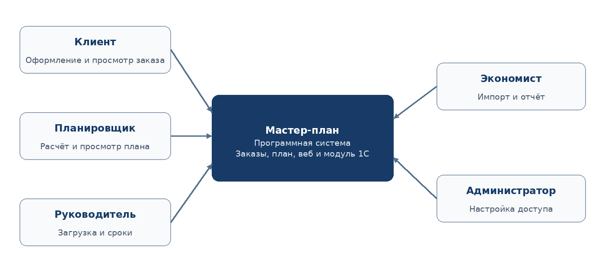
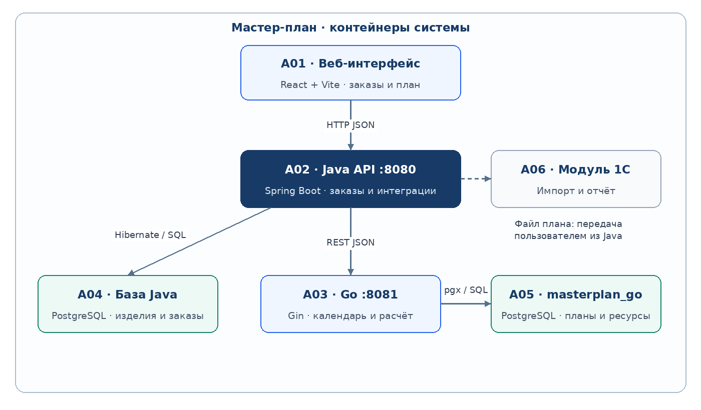
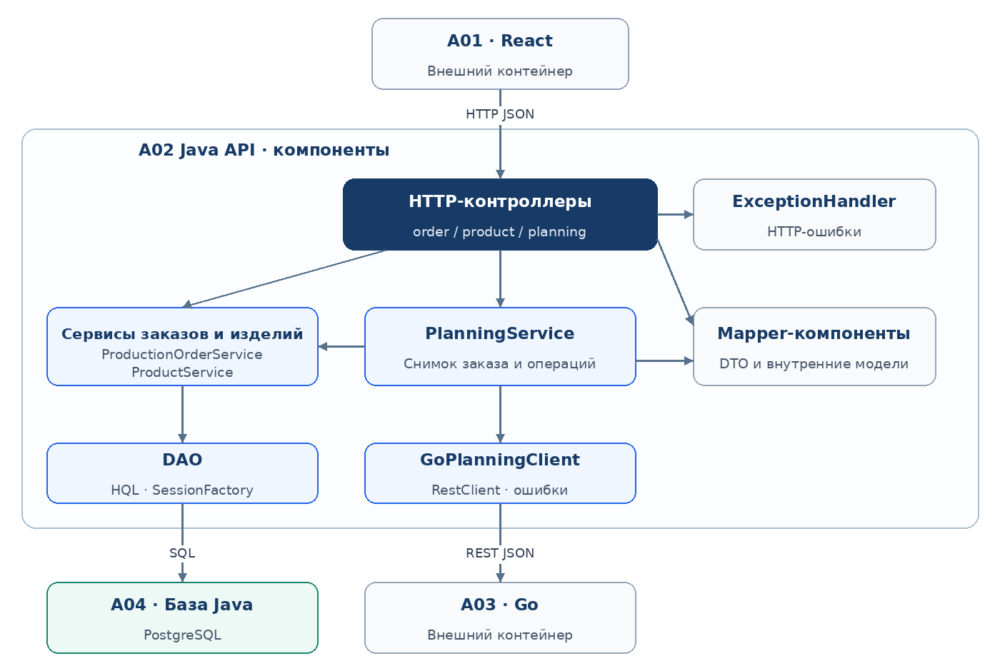
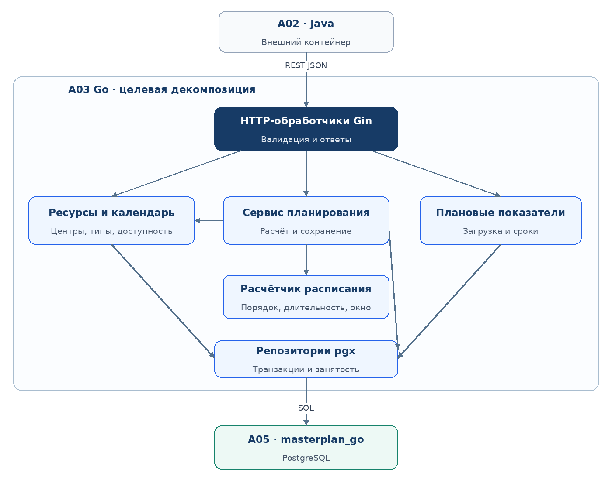
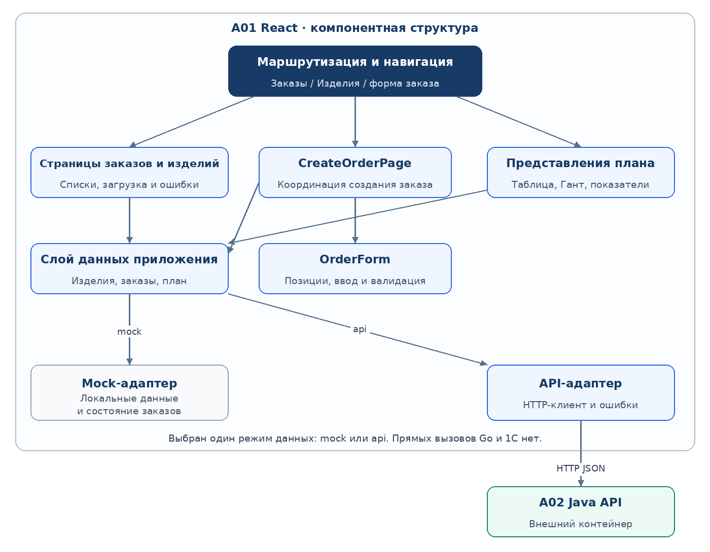
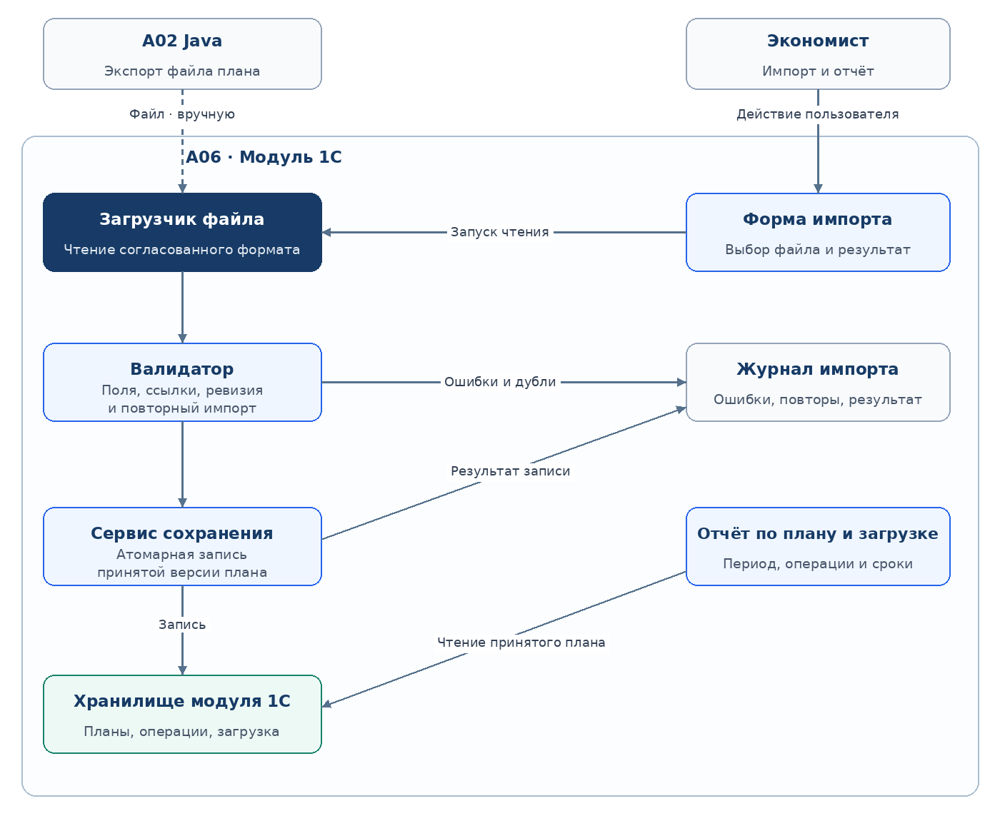

# Целевая архитектура C4 и ответственность

Источник: `Практика 5-6/Архитектура С4, ответстенность.docx`. Перенос в Markdown: 21.11.2026. Статусы и оценки сохранены из источника; перенос не означает утверждения решений или выполнения проверок.

Архитектура системы и ответственность команды

Кейс 22 · Практики 5–6 · Версия 0.2 · 17 ноября 2026 года

Ответственный: Бульдин Захар Андреевич, ЭФБО-01-25. Документ описывает контекст системы, контейнеры и компоненты C4, пакеты работ и RACI. Он связывает архитектуру с текущей реализацией Java, спецификациями Go и планом команды.

Статус: проект редакции для согласования. Схемы показывают целевую архитектуру; наличие блока не доказывает готовность его реализации. В таблицах отдельно указано, что подтверждено описанием кода, а что предстоит сделать.

Основания и границы

Использованы описание текущей Java-части, спецификации Go 01–03, их ревью, исходный документ UseCase/C4, ADR и матрица Ручкиной v0.3, план Проценко v0.2, комплект Корепановой v0.5 и план проверок Домнина v0.1. Репозиторий и работающая система в рамках подготовки не проверялись.

| Входит в архитектуру | Отдельно или за границей |
| --- | --- |
| Заказ клиента, изделия и технология; расчёт операций с учётом мощности и календаря | Материалы и стоимость — Should, не обязательный вход планировщика |
| План, таблица, Гант, плановая загрузка и показатели сроков | Фактические производственные KPI требуют учёта выполнения |
| Файл из Java, импорт и отчёт в 1С | HTTP-интеграция с 1С не принята как базовый способ |
| React, Java, Go, отдельные БД сервисов и модуль 1С | Телеметрия станков, зарплата, полноценная ERP/MES не входят |
| Локальная среда и GitVerse как обеспечение разработки | Страницы работника/начальника и пересчёт по фактам — следующий этап |

Текущее состояние

Java: реализованы order/product и цепочка planning с тремя методами GoPlanningClient. Go: описание схемы и API есть; полноценный планировщик не подтверждён. React: имеются макеты и задания; актуальную интеграцию нужно проверить. 1С: локальная работа со справочниками не подтверждает готовность импорта плана.

Актуальные порты по описанию Java: Java 8080, Go 8081. Старые документы с обратным распределением не использовать как источник настройки.

Как читать схемы

Контекст показывает людей и систему целиком. Container раскрывает исполняемые части и хранилища. Component раскрывает внутреннее устройство одного контейнера. GitVerse и среда запуска не являются компонентами бизнес-логики.

Контекст системы C4

Граница системы включает веб-приложение и модуль 1С. Поэтому 1С не показана как внешняя система. Клиент создаёт заказ; планировщик назначает производственные параметры и запускает расчёт. Руководитель анализирует плановые показатели, экономист работает с импортом и отчётностью.

| Актор | Сценарии и доступ |
| --- | --- |
| Клиент | UC01: выбор изделия и оформление заказа; приоритет и производственный статус не задаёт |
| Планировщик | UC02–UC03: расчёт, просмотр плана; UC05 перепланирование — отдельное расширение |
| Руководитель | UC03–UC04: план, загрузка, сроки и плановые KPI |
| Экономист | UC06–UC07: импорт и отчёт; UC08 стоимость — Should |
| Администратор | Справочники и доступ по утверждённым полномочиям; не отдельный реализованный модуль по факту наличия роли |

Работник и начальник цеха добавляются в контекст будущего этапа. Начальник цеха получает сведения своего цеха; доступ ко всему предприятию нельзя считать разрешённым без определения полномочий.

Контейнеры системы C4

Сплошные линии — программные вызовы и доступ к данным. Пунктир — файловый обмен с ручной передачей. React обращается к Java; Go является внутренним сервисом. Java не читает masterplan_go напрямую, Go не читает таблицы Java.

| Элемент | Технология и граница |
| --- | --- |
| A01 | React/Vite: ввод, отображение, состояние формы и обработка ошибок |
| A02 / A04 | Java 21, Spring Boot 3.5.x, embedded Tomcat; Hibernate 5.6 Jakarta SessionFactory, HQL и PostgreSQL. Имя БД Java брать из конфигурации |
| A03 / A05 | Go, Gin, pgx и masterplan_go; ресурсы, календарь, планы и назначенные операции |
| A06 | Модуль 1С и его данные; собственная проверка импорта и отчёт по конкретной версии плана |
| A07 / A08 | Среда запуска и GitVerse: инфраструктурные элементы, не дополнительные runtime-сервисы |

Две базы PostgreSQL могут работать в одном экземпляре сервера; это не общая схема владения. Межбазовые внешние ключи не используются. В отдельных контейнерах go.base-url задаётся DNS-именем сервиса, а не localhost.

Компоненты Java C4

Схема отражает существующую декомпозицию по описанию Java. Сервисы работают с сущностями и внутренними моделями; контроллеры и mapper формируют внешний DTO. ProductDetails находится в product.model и объединяет продукт, операции и материалы.

PlanningService получает заказ и операции каждой позиции, mapper собирает PlanningRequest, GoPlanningClient выполняет HTTP-вызов. Для расчёта материалы не загружаются. Mapper не читает БД и не вызывает сервисы.

ProductionOrder — шапка, ProductionOrderItem — позиции; повторные productId объединяются суммированием. UNIQUE(order_id, product_id) сохраняется. DAO загружает items/product через join fetch для ответа. DELETE заказа меняет статус на CANCELLED без физического удаления.

Экспортёр файла 1С, серверные права и будущий учёт фактов — целевые дополнения; на схеме текущих компонентов они не объявлены реализованными. XML-инфраструктура подключается через @ImportResource; Boot не означает автоматического перехода на Spring Data JPA.

Компоненты Go C4

Названия блоков — целевые ответственности, а не утверждение о существующих Go-типах. Сервис планирования координирует расчёт и сохранение; расчётчик не формирует HTTP-ответы. Репозитории отвечают за SQL, транзакцию и повторную проверку занятости.

Таблицы по спецификации: work_center, work_center_operation_type, work_center_schedule, production_plan, production_plan_item, scheduled_operation. Внешние идентификаторы Java сохраняются как external_*; технология передаётся снимком, отдельный общий справочник между БД не создаётся.

Доступность календаря не равна свободному времени: свободные окна вычисляются как доступные интервалы минус активная занятость. PROPOSED и ACCEPTED резервируют центр; REJECTED и CANCELLED — нет. Перед записью пересечения повторно проверяются внутри защищённой транзакции.

До приёмки определить ошибки, повтор создания, переходы статусов, горизонт поиска и исход для длинной операции. Недельный шаблон сам по себе не закрывает перерывы и исключения R04; priority без правила очереди не закрывает R05.

Компоненты React C4

Страница CreateOrderPage передаёт изделия и обработчик отправки в OrderForm. Форма управляет полями и валидацией; страница вызывает слой данных. В mock-режиме заказ сохраняется локально и появляется в списке. В api-режиме HTTP-клиент обращается к Java, а интерфейс показывает результат после успешного ответа. Слой данных выбирает один адаптер; одновременное смешение mock и API не допускается.

Схема задаёт целевые обязанности компонентов. Названия блоков не подтверждают наличие конкретных классов или объектов в текущем коде.

Компоненты модуля 1С C4

Экономист выбирает файл, сформированный Java. Загрузчик читает его, валидатор проверяет структуру, идентификаторы, ревизию и повторный импорт. Сервис сохранения атомарно записывает принятую версию. Ошибки и результаты попадают в журнал; отчёт читает сохранённый план. Передача файла ручная, без HTTP-сервера 1С. Материалы и себестоимость относятся к отдельному объёму Should и на этой схеме не раскрываются.

Схема задаёт целевые обязанности компонентов. Названия блоков не подтверждают наличие конкретных классов или объектов в текущем коде.

Ответственность компонентов React и 1С

| Контейнер и компонент | Ответственность | Состояние |
| --- | --- | --- |
| React — страницы | Заказы и изделия в меню; «Создать заказ» ведёт на форму без отдельного пункта навигации | Макеты представлены |
| React — OrderForm | Позиции, количество, дата, комментарий; валидация, блокировка отправки, ошибки | Требует проверки реализации |
| React — слой данных | Отдельные mock/api режимы; единые функции получения и создания заказа; без смешения локальных и серверных записей | Целевая организация |
| React — HTTP-клиент | Обращения только к Java; сериализация запроса и обработка ошибок | Интеграцию подтвердить |
| React — представления плана | Таблица, Гант и показатели одного набора данных | Целевой объём |
| 1С — загрузчик и валидатор | Чтение согласованного файла, схема, обязательные поля, ссылки и повторы | Целевой базовый обмен |
| 1С — хранилище импорта | Атомарное сохранение принятой версии и регистрация ошибок | Целевой базовый обмен |
| 1С — отчёт | Операции, сроки, загрузка; указание плана, версии и актуальности | Целевой базовый объём |
| 1С — материалы и стоимость | Локальные справочники, нормы/цены и учебная модель затрат | Отдельный Should |

Границы формы и API

В локальном режиме созданный заказ появляется в списке средствами состояния фронтенда. В режиме api новый заказ показывается после успешного сохранения Java, с серверным ID. Ошибка запроса не создаёт фиктивный успешный заказ и не очищает введённое.

Запрос создания: dueDate, comment, items с productId и quantity. Названия изделий, ID позиций, createdAt, priority и status не отправляются как управляемые клиентом поля. Контактные поля R02 требуют отдельного согласованного расширения текущего DTO.

Границы обмена

Java формирует файл на основе плана Go. JSON предложен в ADR, но формат должен быть утверждён. Ключ набора, ревизия и правило замены предыдущего плана обязательны для согласования. 1С не становится посредником между Java и Go.

Пакеты работ и матрица RACI

R — выполняет; A — отвечает за итог; C — консультирует; I — информируется. В каждой строке ровно один A, запись A/R объединяет обе обязанности. Владение пакетом не означает, что владелец выполняет все его задачи.

| Пакет WBS | Проценко | Ручкина | Бульдин | Домнин | Корепанова |
| --- | --- | --- | --- | --- | --- |
| 1 Интерфейс React | A/R | R | C | C | I |
| 2 API и интеграция Java | C | C | A/R | C | C |
| 3 Планировщик Go | R | C | C | A/R | I |
| 4 Обмен и отчётность 1С | I | C | R | C | A/R |
| 5 Общие работы и сдача | R | A/R | R | R | R |

Владельцы пакетов сохранены из плана Проценко v0.2. Бульдин остаётся руководителем проекта, но не подменяет владельцев всех пакетов. Проценко участвует в пакете Go как исполнитель контрольного замера З-19 по текущему плану.

| Результат практик 5–6 | Проценко | Ручкина | Бульдин | Домнин | Корепанова |
| --- | --- | --- | --- | --- | --- |
| C4 и границы компонентов | C | C | A/R | C | C |
| RACI по пакетам | C | C | A/R | C | C |
| WBS и календарный план | A/R | C | C | C | C |
| ADR и трассируемость | C | A/R | C | C | C |
| План проверок и риски | C | C | C | A/R | C |
| Протоколы и сводный отчёт | C | C | C | C | A/R |

Эта матрица уточняет ответственность за текущие пакеты и документы, а не переносит все БД одному Data Engineer. За схему Java отвечает Бульдин, Go — Домнин, данные 1С — Корепанова; Ручкина согласует интеграционные наборы и связи.

Коды участников сохраняются для старых документов: R1 — Ручкина, R2 — Бульдин, R3 — Домнин, R4 — Корепанова, R5 — Проценко. Это обозначения людей; они не ограничивают фактические роли разработки.

Контракты и архитектурные ограничения

| Граница | Подтверждено или требуется |
| --- | --- |
| React → Java | Подтверждены POST/GET /api/orders, GET/DELETE /api/orders/{id}, GET /api/products и /api/products/{id}. Точные URL PlanningController взять из кода |
| Java → Go | Реализованы методы клиента: createPlan → POST /api/plans; getOrderPlan → GET /api/plans/orders/{orderId}; getWorkCenters → GET /api/work-centers |
| Задание на расчёт | orderId, earliestStartAt, dueDate, priority, items; позиция: orderItemId, productId, quantity, operations; операция: operationId, sequenceNumber, operationType, timePerUnitSeconds |
| Ответ плана | planId, orderId, plannedStartAt, plannedFinishAt, onTime, status, items с operations. POST и GET должны возвращать полный план; прежний короткий POST-ответ Go требует исправления |
| Время и ошибки | OffsetDateTime и зона Europe/Moscow; отсутствие плана 404, недоступный Go 503, прочая ошибка Go 502 по текущему Java handler. Правило срока и таймауты уточняются |
| Файл → 1С | Единый утверждённый формат, идентичность и ревизия набора, повтор без дублей, атомарная замена и согласованность отчёта |

Открытые решения

Методы weekly schedule, availability, общего расписания и accept/reject/cancel в Java пока не подтверждены реализацией. Логическая отмена Java-заказа не доказывает освобождение резерва Go. Повторный POST нельзя автоматически повторять после сбоя без согласованного ключа или другого безопасного правила.

Статус заказа отличается от статуса плана. Машину переходов и реакцию Java на Go нужно утвердить отдельно. Внешние вызовы не становятся общей транзакцией двух баз; необходимы явный исход, повтор и сверка состояния.

Связи с ADR и проверками

Разделение данных — ADR-0001, T-03/T-05/T-19; цепочка вызовов — ADR-0002, T-18/T-20; файл 1С — ADR-0003, T-11/T-12; Java-конфигурация — ADR-0004, T-14/T-16. Полную цепочку R → A → задача → T ведёт Ручкина; этот документ её не дублирует.

Будущий этап учёта выполнения

Расширение ADR-0007 предусматривает страницы работника и начальника цеха. Это предложение следующего этапа, не выполненный функционал и не автоматическое расширение Must текущего MVP.

| Элемент | Дополнение и ответственность |
| --- | --- |
| A01 React | Проценко: задания закреплённого станка и отметки работника. Ручкина: сводка начальника, отклонения, запуск пересчёта, просмотр и подтверждение варианта |
| A02 / A04 Java | Бульдин: факты выполнения, автор и время, история исправлений, серверные права, устойчивый ID производственной операции и версии снимка |
| A03 / A05 Go | Домнин: учёт оставшейся работы и простоев, сохранение завершённых операций, проверка актуальности варианта, атомарная замена резервов |
| A06 1С | Корепанова: отчёт по действующему плану после согласованного обновления обмена; 1С не участвует как обязательный посредник пересчёта |
| QA и документация | Домнин: T-21–T-27; Ручкина: R33–R39 и ADR; Проценко: план; Бульдин: контракты и C4; Корепанова: изменения и сводка |

Поток изменений

Работник сохраняет факт через Java. Начальник уточняет задержку, поломку и доступность; затем запускает пересчёт. Java передаёт Go согласованный снимок фактов, остатков и ограничений. Go предлагает вариант. Начальник сравнивает его с текущим и подтверждает; при изменившихся данных подтверждение отклоняется как конфликт.

Завершённая операция не планируется повторно. Для 12 выполненных из 20 переносится остаток 8 только при технологической допустимости и прекращении исходной работы. Неизвестный срок ремонта не заменяется выдуманной датой. Факты привязаны к производственной операции, а не только к изменяемому назначению на станок.

| Предлагаемый UC | Содержание |
| --- | --- |
| UC09 | Работник просматривает задания станка и фиксирует выполнение |
| UC10 | Начальник просматривает план/факт и уточняет отклонения |
| UC11 | Начальник запускает пересчёт остатка и подтверждает актуальный вариант |

В исходнике есть UC01–UC08; UC09–UC11 предлагаются как новые номера после сверки общего реестра. UC05 описывает общее перепланирование; UC11 уточняет новый процесс по фактам. R14/R18 не означают, что весь этот процесс уже включён в текущий этап.

Согласование документов и приёмка архитектуры

Обнаружено расхождение нумерации дополнительных задач. Для исполнения и календаря использовать план Проценко v0.2; старые ссылки матрицы нельзя трактовать без описания задачи. Ниже приведено соответствие по смыслу.

| Предмет | План Проценко v0.2 | Матрица Ручкиной v0.3 |
| --- | --- | --- |
| Контакты клиента | ДОП-01 | ДОП-01 |
| Календарь и исключения | ДОП-02 | ДОП-03 |
| Приоритет и опоздание | ДОП-03 — одна задача | ДОП-02 и ДОП-04 |
| Серверные права | ДОП-04 | Сверить ссылки по смыслу |
| Конкурентность и повторы | ДОП-05 | ДОП-05 — уточнить границы |
| Отчёт и обмен 1С | З-13, З-23, З-24 | ДОП-06; не начислять часы повторно |

Ручкина обновляет ссылки матрицы и ADR, Проценко подтверждает сохранение оценок и зависимостей. Документ Домнина v0.1 использует прежние ДОП-ссылки из матрицы: при синхронизации их также нужно заменить; номера T-01–T-27 сохраняются.

Разделение QA и исполнительских задач

Домнин отвечает за программу проверок и сбор результатов. В плане З-19 контрольный замер выполняет Проценко, З-27 сквозную приёмку ведёт Бульдин. Эти назначения сохраняются: Домнин готовит методику и сводный протокол, исполнители выполняют свои проверки. Самостоятельное ревью Go выполняет Бульдин.

Что проверяет Бульдин перед согласованием

1. Все соединения схем имеют понятный протокол и владельца; сервисы не пишут в чужие БД. 2. Три существующих метода Java-клиента совпадают с Go по URL и полному ответу. 3. В RACI один A на строку. 4. Пакеты совпадают с WBS, ответственность за БД указана по сервисам. 5. Целевая архитектура не выдаётся за реализацию. 6. Будущий этап отделён от текущей приёмки.

Результат и размещение

Предлагаемые пути: docs/architecture/ для описания и схем; TEAM.md для RACI; docs/adr/ для решений Ручкиной. Утверждение фиксируется ссылкой на ревью и принятую редакцию в GitVerse. В рамках подготовки этого файла репозиторий не изменялся.

Следующие действия: Бульдин сверяет схемы с актуальным кодом; владельцы контейнеров подтверждают границы; Ручкина и Проценко устраняют расхождения ссылок; Домнин привязывает проверки к согласованной ревизии; Корепанова фиксирует решение. До этого статус комплекта — «На согласовании».

## Схемы из исходного документа

